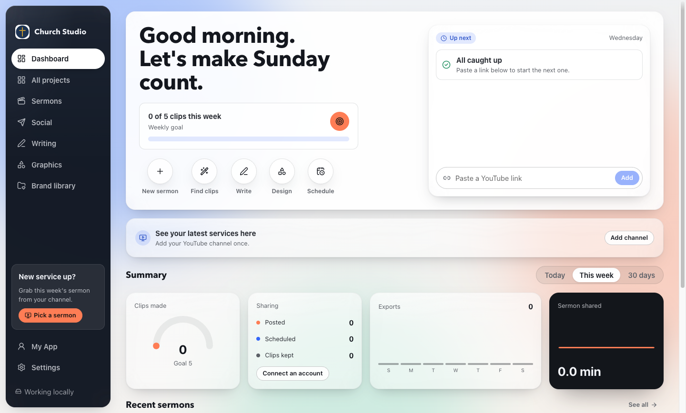
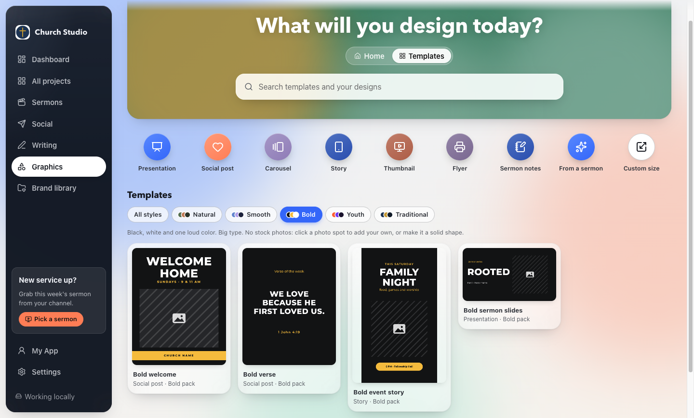
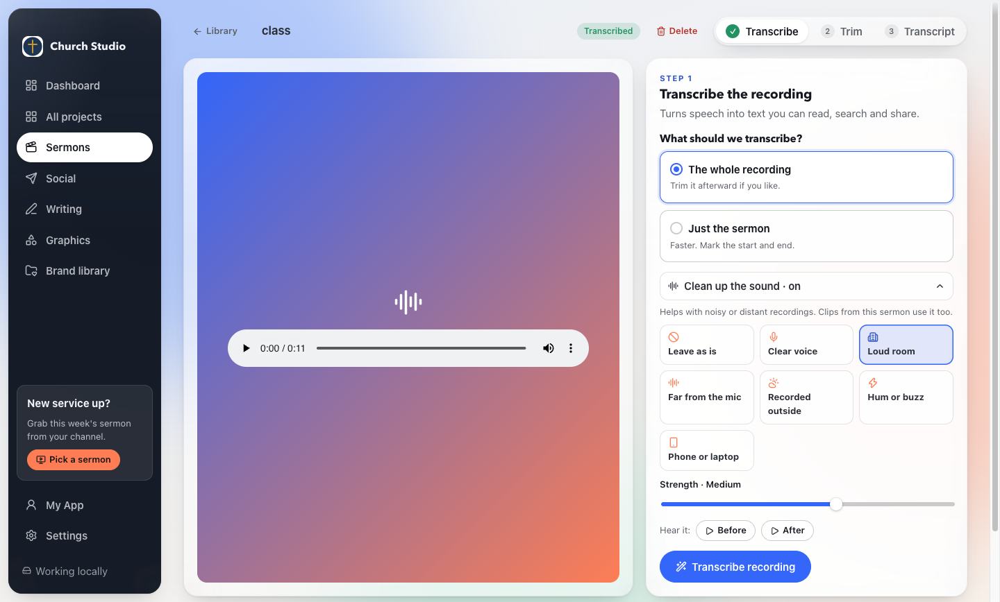
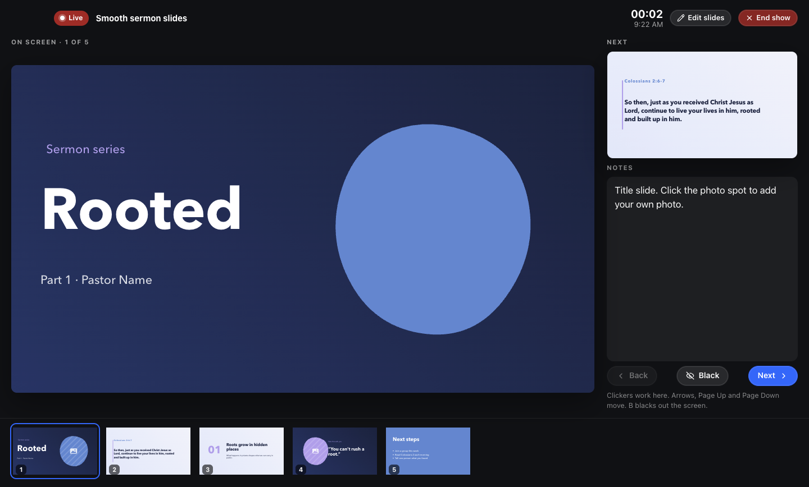
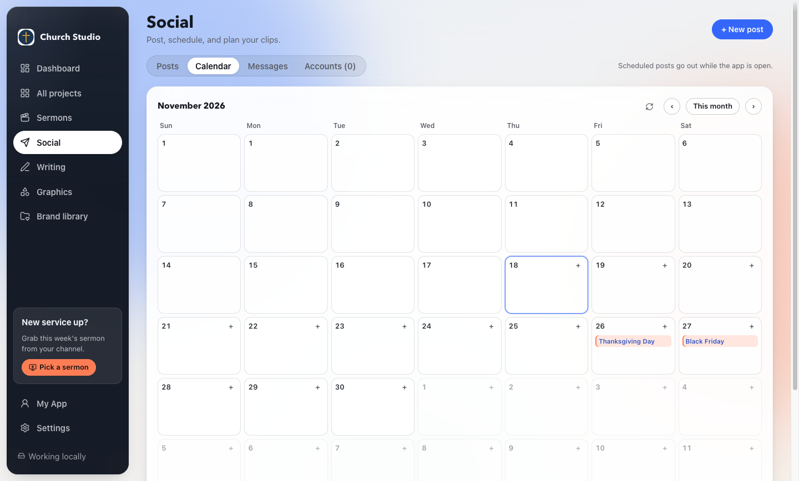
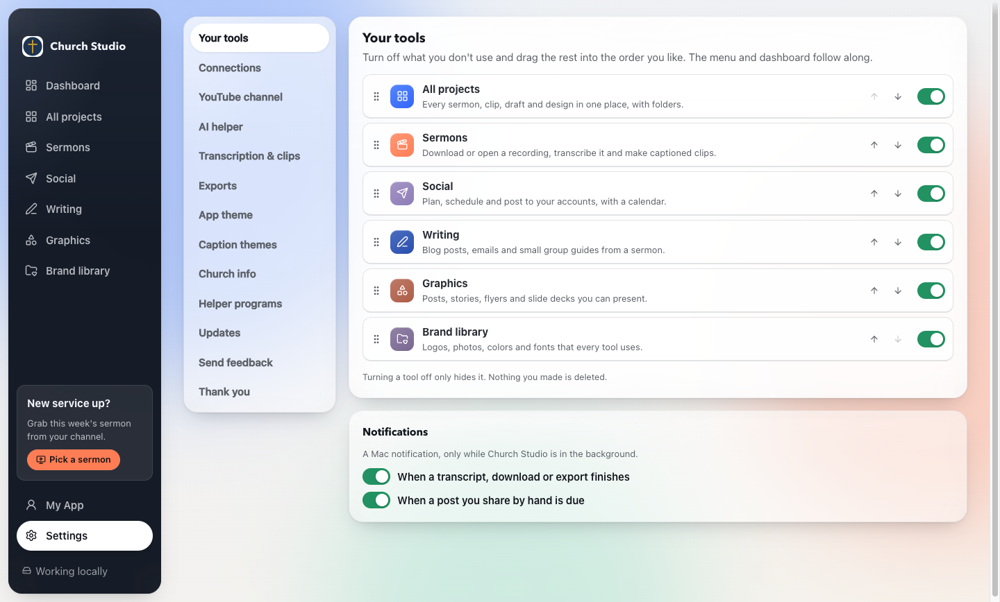

<p align="center"></p>

Church Studio is a full communications studio built for churches, all in one Mac app. Start with Sunday's
sermon and turn it into captioned clips, a transcript, a blog post, an email, a small group guide, social
graphics and a slide deck you can present on a second screen. Plan and post to your social accounts on a
calendar that sits next to your church's own events, with your logo, colors and fonts everywhere.
It all runs on your Mac with no account, no cloud and no AI required, so a small staff or a volunteer can do
in an afternoon what used to take a week.

<details>
<summary><strong>Screenshots</strong></summary>

| | |
|---|---|
|  **Dashboard** shows what's next and only the tools you use. |  **Graphics** with five template packs, photo frames and device mockups. |
|  **Transcribe** any recording, with one-tap audio cleanup. |  **Present** to a second screen with notes, next slide and live edits. |
|  **Calendar** with your church events beside your posts. |  **Your tools**: turn tools on or off and set their order. |

</details>

## Run it

```sh
scripts/setup.sh        # once: Python venv + npm packages (ffmpeg comes bundled via npm)
npm start               # build the UI and open the app
npm run dev             # hot reload: UI + daemon + Electron
npm test                # engine tests (no network)
```

## Package it as one app

```sh
scripts/build-app.sh    # -> dist/release/Church Studio-<version>-arm64.dmg
```

The `.app` contains everything: a frozen Python media engine (`sc-media`: Whisper, OpenCV, Pillow,
yt-dlp), static ffmpeg/ffprobe, fonts, the UI and the local daemon. Nothing else needs installing.
Data lives in `~/Library/Application Support/Church Studio`. The Whisper model downloads once on first
transcription. The build is signed ad hoc (no Apple developer account), so the first launch shows a warning: click Done,
then open System Settings › Privacy & Security and choose Open Anyway next to Church Studio.

## How it works

1. **Add a sermon.** Pick from your channel, paste a link, or open any audio or video file on your Mac
   (a class, a podcast, a phone recording). Before downloading, the app reads YouTube's
   captions and finds the sermon. "Just the sermon" downloads at full speed, then keeps only that part.
2. **Transcribe** with faster-whisper on this Mac (word timings). Optional audio cleanup first: Clear voice,
   Loud room, Far from the mic, Recorded outside, Hum or buzz, or Phone or laptop, with a strength slider and a
   before and after sample. Plain ffmpeg filters, no AI. Clips use the same cleanup, and any recording can get a
   cleaned copy. Transcripts save as text, text with times, or .srt and .vtt captions.
3. **Confirm the sermon** on a timeline and scene strip.
4. **Clips** are suggested by offline scoring tuned for preaching. An optional AI helper can rerank them.
5. **Edit:** live preview, word cuts, trims, pause trimming (you pick the length), a movable themed hook, the
   caption theme editor built in, logo and end card, edit templates, undo/redo, and a save prompt when leaving.
   Framing: a Follow closely to Smooth glide slider, "click the speaker" hints that improve tracking over time,
   timestamp cues (cut or glide), fixed, whole frame or three stack (blurred or solid background).
6. **Export:** 9:16, 4:5, 1:1 or 16:9; 720p to 4K; H.264 or HEVC. Saves to Downloads, then asks where you want it.
7. **Social:** post now, schedule, or draft. See `docs/SOCIAL.md`.

The home screen is a dashboard: weekly goal, quick actions, what's up next, your channel's latest services,
and a summary of clips and posts.

More tools:
- **Writing:** blog post, email summary, small group guide and social captions written from the sermon's own
  words. You edit the formatted text with a toolbar (styles, bold, italic, links, lists, indent) or switch to
  Markdown. Blog posts get suggested titles, keyphrases, web addresses and meta descriptions, and "Rewrite post"
  rebuilds them around a new angle (main points, story first, practical steps, questions, devotional, newcomers).
  SEO and readability checks run as you type. Optional AI polish keeps every fact from the sermon.
- **Bible references:** spoken references are written the standard way in transcripts, captions and writing
  ("First Corinthians 10 beginning in verse 16" becomes "1 Corinthians 10:16"). Whisper also gets book-name hints.
- **Graphics:** a design home ("What will you design today?") for presentations, social posts, carousels,
  stories, thumbnails, flyers, sermon notes and custom sizes. Multi-page designs, templates in your brand
  colors and fonts, "From a sermon" (slides, carousels, stories and notes built from the transcript),
  smart alignment guides and grid snapping, inline text editing, and export to PNG, PDF or PowerPoint (with
  speaker notes). Five template packs (Natural, Smooth, Bold, Youth, Traditional) with photo spots instead of
  stock photos. Any shape can hold a photo or work as an eraser, there are iPhone and MacBook frames, and SVG
  colors can be changed one by one. Present on this screen, or to a second screen with a presenter console
  (next slide, notes, timer, black screen, clicker support) where edits to the live slide wait until you press
  Update screen. Saved graphics can go into a clip as a corner logo or an end card.
- **Brand library:** a normal folder in Documents (Photos, Logos, Graphics, Brand, Writing) that every tool uses,
  with a brand kit (colors, including "colors from my logo", and heading and body fonts) and a setup checklist.
- **All projects:** sermons, clips, writing and designs in one place, with folders (drag items onto them),
  stars, recents and a trash for designs and writing.
- **Printable guides:** any writing prints or saves as a PDF, full page (guides get the sermon outline down the
  left third) or half page (two 5.5 × 8.5 in copies per sheet). Header images can be a photo, a graphic or a
  still from the sermon video. Your logo and church info go in the footer.
- **Status:** the sidebar says "Working locally", or "Working with Claude" (or another helper). If the helper
  hits a usage limit, the app quietly works locally and shows a note.
- **Church calendar:** add one or more calendar links (.ics) from Planning Center, Church Center, Subsplash,
  Tithe.ly, Google or Outlook. Events show on the social calendar and the dashboard, and become
  graphics in one click. Checked once a week, on Monday mornings, or when you press refresh.
- **Your tools:** a welcome window on first run asks what kinds of work you do. Turn tools on or off and set their
  order anytime in Settings; the menu and dashboard follow.
- **Your logo:** the menu shows your church logo, and the Dock icon becomes your logo with a small CS badge.
- **Notifications:** a Mac notification when a long task finishes or a post you share by hand is due, only while
  the app is in the background.
- **Feedback:** Settings › Send feedback takes a star rating and a note. With a relay set up (`relay/`,
  `feedbackUrl` in package.json) it becomes a GitHub issue without the sender needing an account.
- **Workspaces:** separate brands or ministries, each with its own settings, sermons, accounts and library.
- **My App:** your setup at a glance, plus ideas based on your sermon topics.

Open-source credits: `CREDITS.md`, also shown in Settings › Thank you.

## Updates

Settings › Updates checks GitHub releases (`updateRepo` in package.json), shows the notes, and downloads the
new .dmg. Data lives outside the app, and the first launch of a new version backs up settings and data files
to `backups/` (last five kept) before running any migrations. See `docs/RELEASING.md`.

## Layout

```
electron/        window + preload
src/daemon/      local HTTP daemon on 127.0.0.1:4317 (job queue, media, social)
src/ui/          React + Vite UI (liquid glass, light and dark themes)
scripts/         setup.sh, build-app.sh, transcribe.py, render_clip.py, list_fonts.py, sc_media.py
assets/fonts/    Montserrat and Caveat (OFL)
docs/            architecture, theming, social hub, releasing, README images
relay/           optional feedback relay (Cloudflare Worker)
```

## Notes
- Settings and optional AI keys: `config.local.json`. Social credentials are encrypted in `data/social/`.
- Speaker tracking uses OpenCV face detection (`opencv-python-headless<5`). YuNet/YOLO is the next upgrade.
- Captions are drawn in Python (Pillow), so ffmpeg doesn't need libass.
- UI follows `docs/ui-ux-guide.md`: tokens only, one button system, plain copy.
